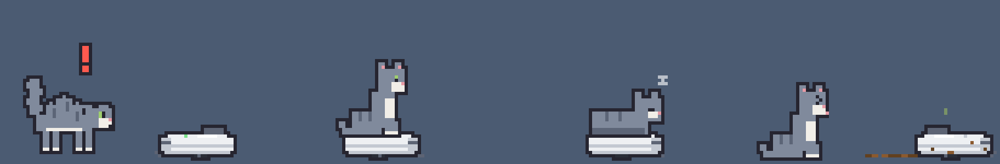

# 毛球貓 DLC

[毛球貓 YarnCat](https://github.com/chyhhwen/Yarncat) 的 DLC。一個 `.yarncat` 檔就是一個 DLC，挑喜歡的裝，也可以全部一起裝。

| DLC | 檔案 | 內容 |
| --- | --- | --- |
| [老大貓與健身貓](#老大貓與健身貓) | `boss-gym.yarncat` | 兩種毛色、三件健身器材 |
| [掃地機器人](#掃地機器人) | `vacuum.yarncat` | 一台會自己出來打掃的掃地機器人 |

## 安裝

要毛球貓 1.5.0 以上，Microsoft Store 版、GitHub 版都可以。舊版的話，「系統」分頁會寫「要毛球貓 1.5.0 以上」。

1. 下載想要的 `.yarncat` 檔。
2. 左鍵點系統匣的貓咪圖示，到「系統」分頁按「打開 DLC 資料夾」，把檔案放進去。這個資料夾就是 `圖片\YarnCat\dlc`（macOS 是 `~/Pictures/YarnCat/dlc`）。
3. 在系統匣按右鍵選「結束毛球貓」，再從開始功能表打開。
4. DLC 的毛色到「毛色」分頁選；DLC 的家具會直接擺在地上，不要哪一件，就到「家具」分頁收起來。

裝好之後，「打開 DLC 資料夾」底下會列出載入了哪些：有毛色的 DLC 寫毛色，沒有的寫檔名。出錯的話也寫在那裡。不要了就把檔案刪掉再重開。

DLC 是程式碼，會在毛球貓裡執行：只裝信任的人給的 `.yarncat` 檔。

## 老大貓與健身貓

`boss-gym.yarncat`，裝了會多兩種毛色和三件健身器材：

- **老大**：叼著魚乾的橘紅大公貓，耳朵缺一角、額頭一道疤。會巡視地盤、趴著啃魚乾。把魚乾從牠嘴上抽走，牠就跟著走、坐著討；拿太高太久，牠就坐下來瞪你。跟隔壁來的客人碰完鼻子，會把魚乾留給客人。
- **健身**：綁紅頭帶的白貓，比別的貓更常去練健身器材。
- **健身器材**：臥推椅、跑步機、高拉背機。跟貓砂盆它們一樣是家具：可以拖，拎高放開會掉下來，狀態視窗的「家具」分頁可以個別收起來。每一隻貓都會隔一陣子自己去練；點一下器材，叫貓馬上過去練。
  - 跑步機：練的時候點一下加速。最快的速度撐太久，會被甩出去，落地炸毛。
  - 高拉背機：練的時候點一下加重量。最重的拉不動，會被拉離座椅，鬆手掉下來炸毛。

裝好之後，「已載入」會寫「老大、健身」。刪掉之後器材會收掉，選著 DLC 毛色的貓會變回藍灰。

## 掃地機器人

`vacuum.yarncat`，裝了地上會多一台掃地機器人，每一隻貓都會跟它玩：

- **打掃**：隔一陣子自己出來掃一趟，安靜模式時不會出來。撞到家具、畫面邊邊就倒退掉頭，碰到毛球就頂著滾走；卡在兩個東西中間，會停下來閃橘燈。點一下出發，再點一下停下來。
- **吸地**：地上的便便、貓砂盆翻倒灑出來的貓砂都會吸掉。偶爾會輾過便便，拖著走一路，附近的貓會被臭到。
- **貓**：第一次看到它動會嚇到炸毛。習慣以後會壓低身體偷偷靠近，撲上去搭便車，搭著也能摸；累了會趴在停著的機器人上睡覺。把機器人拖走，上面的貓會掉下來。

這個 DLC 沒有毛色，所以「已載入」寫的是檔名 `vacuum.yarncat`。

## 開發

`.yarncat` 檔是 JavaScript，毛球貓開機時照檔名順序讀進來跑（主程式 `src/index.html` 的「DLC」段落）。每個檔案包在自己的函式裡，裡面的 `const`、`function` 不會跟主程式、別的 DLC 撞名；主程式所有的函式和變數（`cat`、`setState`、`standPose`……）都能用。角色、家具要提供哪些函式，見主程式的「角色」「DLC 家具」段落。

- **測試**：用瀏覽器打開主程式的 `src/index.html`，把 `.yarncat` 檔拖進視窗，畫面會重新整理一次；可以拖好幾個。按 `c` 換毛色。
  - 拖進去的檔案存在那個分頁裡，重新整理也還在，關掉分頁就沒了。改了檔案，再拖一次就好。
  - 網頁版沒有狀態視窗，家具不能收起來。
- **測試按鍵**：貓閒著的時候按，叫牠馬上去做。
  - 老大貓與健身貓：老大按 `p` 巡視地盤、`f` 趴下來啃魚乾；不管哪一隻，按 `b` 臥推、`m` 跑步機、`l` 高拉背機。
  - 掃地機器人：按 `r` 讓機器人出發，再按一次停下來；按 `t` 叫貓跳上去。
- **出錯**：瀏覽器的開發人員工具（F12）看得到錯在哪一行，檔名是 `dlc/` 加上檔案名稱，例如 `dlc/boss-gym.yarncat`。桌寵版的錯誤會寫在狀態視窗的「系統」分頁。
- **WebStorm**：到 Settings → Editor → File Types → JavaScript，加上 `*.yarncat`，才會當成 JavaScript 上色、檢查。
- **主程式改版**：主程式改了 DLC 用到的名字，那個 DLC 就會出錯。主程式不會因此停住：載入時出錯就整個不載入，跑到一半出錯就停掉那隻貓的專屬動作、收掉出錯的家具。所以主程式改版之後，每個 DLC 都用上面的方法測一次。
