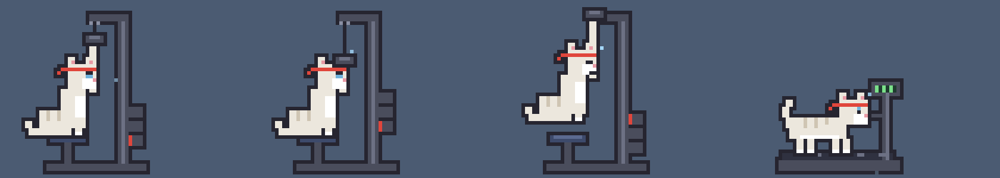
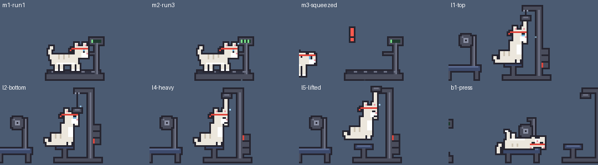

# 毛球貓 DLC：老大貓與健身貓

[毛球貓 YarnCat](https://github.com/chyhhwen/Yarncat) 的 DLC。整個 DLC 就是一個檔案 `boss-gym.yarncat`，裝了會多兩種毛色和三件健身器材：

- **老大**：叼著魚乾的橘紅大公貓，耳朵缺一角、額頭一道疤。會巡視地盤、趴著啃魚乾。把魚乾從牠嘴上抽走，牠就跟著走、坐著討；拿太高太久，牠就坐下來瞪你。跟隔壁來的客人碰完鼻子，會把魚乾留給客人。
- **健身**：綁紅頭帶的白貓，比別的貓更常去練健身器材。
- **健身器材**：臥推椅、跑步機、高拉背機。跟貓砂盆它們一樣是家具：可以拖，拎高放開會掉下來，狀態視窗的「家具」分頁可以個別收起來。每一隻貓都會隔一陣子自己去練；點一下器材，叫貓馬上過去練。
  - 跑步機：練的時候點一下加速。最快的速度撐太久，會被甩出去，落地炸毛。
  - 高拉背機：練的時候點一下加重量。最重的拉不動，會被拉離座椅，鬆手掉下來炸毛。

## 安裝

要毛球貓 1.5.0 以上，Microsoft Store 版、GitHub 版都可以。舊版的話，「系統」分頁會寫「要毛球貓 1.5.0 以上」。

1. 下載 `boss-gym.yarncat`。
2. 左鍵點系統匣的貓咪圖示，到「系統」分頁按「打開 DLC 資料夾」，把檔案放進去。這個資料夾就是 `圖片\YarnCat\dlc`（macOS 是 `~/Pictures/YarnCat/dlc`）。
3. 在系統匣按右鍵選「結束毛球貓」，再從開始功能表打開。
4. 地上多了三件健身器材。到「毛色」分頁可以選「老大」或「健身」；不要哪一件器材，就到「家具」分頁收起來。

裝好之後，「打開 DLC 資料夾」底下會寫「已載入：老大、健身」；出錯的話也寫在那裡。不要了就把檔案刪掉再重開：器材收掉，選著 DLC 毛色的貓會變回藍灰。

DLC 是程式碼，會在毛球貓裡執行：只裝信任的人給的 `.yarncat` 檔。

## 開發

`boss-gym.yarncat` 是 JavaScript，毛球貓開機時讀進來跑（主程式 `src/index.html` 的「DLC」段落）。主程式所有的函式和變數（`cat`、`setState`、`standPose`……）都能用；角色、家具要提供哪些函式，見主程式的「角色」「DLC 家具」段落。

- **測試**：用瀏覽器打開主程式的 `src/index.html`，把 `boss-gym.yarncat` 拖進視窗，畫面會重新整理一次。按 `c` 換毛色。貓閒著的時候，老大按 `p` 巡視地盤、`f` 趴下來啃魚乾；不管哪一隻，按 `b` 臥推、`m` 跑步機、`l` 高拉背機。
  - 拖進去的檔案存在那個分頁裡，重新整理也還在，關掉分頁就沒了。改了檔案，再拖一次就好。
  - 網頁版沒有狀態視窗，器材不能收起來。
- **出錯**：瀏覽器的開發人員工具（F12）看得到錯在哪一行，檔名是 `dlc/boss-gym.yarncat`。桌寵版的錯誤會寫在狀態視窗的「系統」分頁。
- **WebStorm**：到 Settings → Editor → File Types → JavaScript，加上 `*.yarncat`，才會當成 JavaScript 上色、檢查。
- **主程式改版**：主程式改了這裡用到的名字，這個 DLC 就會出錯。主程式不會因此停住，只會停掉這兩隻貓的專屬動作、收掉出錯的器材。所以主程式改版之後，用上面的方法測一次。
